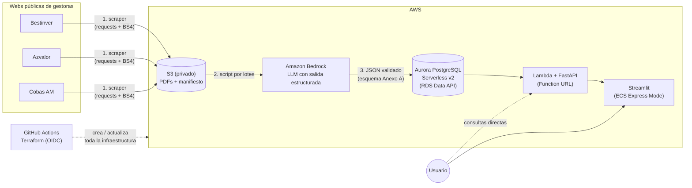

# Arquitectura

> Versión actual: **la de referencia de los talleres**. Si cambiamos alguna pieza, actualizar este
> diagrama y justificarlo en [decisiones.md](decisiones.md).

## Recorrido de un KID, paso a paso

1. **Captura.** El scraper entra en la ficha del fondo, encuentra el enlace al PDF, lo descarga,
   calcula su huella SHA-256 y lo sube a S3. Apunta una línea en el manifiesto (fuente, URLs, fecha).
2. **Extracción.** El script de extracción lee el manifiesto, coge cada PDF de S3 y se lo pasa a Bedrock
   junto con el esquema de [`esquema_kid.py`](../extraccion/esquema_kid.py). El modelo devuelve los campos
   respetando el esquema. Validamos en Python y marcamos los que haya que revisar a mano.
3. **Carga.** Insertamos en PostgreSQL con «upsert» (si el PDF ya estaba, se actualiza en lugar de duplicarse).
4. **Servicio.** La API (FastAPI en Lambda) consulta la base de datos y devuelve JSON.
5. **Visualización.** La app Streamlit llama a la API y pinta tablas y gráficos.
6. **Despliegue.** Toda la infraestructura la crea Terraform desde GitHub Actions, que entra en AWS por OIDC (sin claves guardadas).

## Qué es público y qué no

| Pieza | ¿Accesible desde Internet? |
|---|---|
| Bucket S3 | ❌ No (bloqueo de acceso público) |
| Base de datos | ❌ No (solo vía Data API con permisos IAM) |
| API (Function URL) | ✅ Sí — es una de las dos puertas permitidas |
| App Streamlit | ✅ Sí — es la otra puerta permitida |
